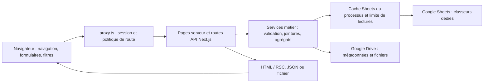

# Cahier des charges de l’audit CPU du COC

Date : 22 octobre 2026 (Europe/Paris). Statut : cadrage initial, lecture et documentation uniquement.

## 1. Objectif, périmètre et niveau de preuve

Déterminer quels parcours et traitements contribuent à la consommation CPU Vercel du système de gestion du Comité Olympique Congolais, puis établir une référence permettant d’évaluer une intervention ultérieure sans régression métier ni d’accès. Aucun gain n’est mesuré ou annoncé dans ce cadrage.

Périmètre exclusif : `C:\Projets\SNDS-HARMONISATION\coc-cible`. Aucun travail dans les autres dépôts. Aucune transposition des optimisations FEBACO : la liste athlètes COC possède déjà une projection explicite et ne suit pas le même parcours d’enrichissement/licences. Les pistes devront être justifiées par des observations COC.

Les mentions suivantes qualifient les affirmations :

- **OBS** : résultat observé pendant cette intervention, avec méthode indiquée.
- **CODE** : comportement du répertoire de travail lu, sans garantie qu’il soit publié.
- **DOC** : exigence ou résultat historique rapporté, sans reproduction.
- **HYP** : mécanisme susceptible de contribuer au coût, à mesurer.
- **MANQUE** : information non établie.

**DOC / déclaration utilisateur** : production existante, quotas CPU dépassés, données encore peu nombreuses et plusieurs utilisateurs après formation. Aucun export de consommation, nombre de lignes ou relevé de simultanéité n’étaye encore ces éléments. Le nombre d’utilisateurs n’est pas retenu comme cause démontrée.

Référentiel métier et sources officielles : [annexe des sources](audit-cpu-sources-2026-10-22.md). Elle recense les cahiers PDF, les ADR, les rapports antérieurs et les limites Vercel documentées. Le cahier COC exige notamment de ne charger que les données nécessaires, d’éviter les traitements répétés et de maintenir contrôles serveur et traçabilité.

## 2. Identification du dépôt et écart avec la production

**OBS — commandes exécutées dans coc-cible** : `git status --short`, `git branch --show-current`, `git rev-parse HEAD`, `git remote -v`, `git log -1`, inventaire `rg --files`. Aucun `AGENTS.md` trouvé dans le dépôt ni aux niveaux `C:\`, `C:\Projets` et `C:\Projets\SNDS-HARMONISATION` consultés.

| Élément | État au début de l’intervention |
| --- | --- |
| Branche | `design/coc-febaco-visual-20261019` |
| HEAD | `c1488d33b6fcd2953d2bf0becc25a83055e13e2f` |
| Dernier commit local | 20 octobre 2026, 14:09:43 +02:00, `Harmonize COC interface with FEBACO reference` |
| Origin fetch | `https://github.com/Rodanyoca/coc-managment.git` |
| Origin push | `DISABLED` |
| Arbre local initial | 22 fichiers suivis modifiés/supprimés : 21 modifications et suppression de `.env.example` ; 4 fichiers non suivis préexistants |
| Diff suivi initial | 105 insertions, 73 suppressions ; aucun de ces changements n’est produit par cet audit |
| Technologies déclarées | Next.js `^16.3.4`, React `19.2.4`, `googleapis ^174.0.1`, App Router ; pas de configuration Vercel locale trouvée |

Les changements locaux concernent notamment les listes/détails des acteurs, activités, layout, contexte d’accès, bouton de rafraîchissement, création utilisateur, `lib/auth.ts`, `lib/auth/authorization.ts`, `lib/auth/post-login-route.ts` et leurs tests. Fichiers non suivis initiaux : `components/dashboard/access-context.tsx`, `docs/sommaire-mode-emploi-processus-metier.md`, `lib/users/create-user-client.ts`, `tests/unit/create-user-client.test.ts`. Ils sont inclus dans la lecture du fonctionnement actuel et préservés. Aucun commit, reset, stash, changement de branche ou fetch Git effectué. La version des dépendances réellement publiée n’est pas établie par les seules contraintes de `package.json`.

**OBS — Vercel** : `list_projects` identifie `coc-managment`, ID `prj_GfEgDmQ9y6SvELDNuHZyPYNcTYbA`, compte `team_f8eup9TubcHKCbP7dlKhD4sz`. Ce résultat est un indice de correspondance avec origin, pas une preuve du commit publié. `get_project` et `get_team` refusent ensuite l’accès (403, scope `yoca-souleymane-s-projects`). Une demande d’accès à l’équipe a été présentée, l’utilisateur l’a validée dans le chat ; une reprise de ces lectures retourne encore 403. Ne pas assimiler l’accord dans le chat à un accès techniquement effectif.

**OBS — secours CLI** : version 64.5.0 ; `vercel project inspect --non-interactive` retourne `link_required` ; aucune liaison créée. L’inspection explicite de `coc-managment` dans le compte identifié échoue avec `fetch failed` et erreurs du cache de mise à jour CLI. Aucune escalade, authentification automatique, installation ou mutation de configuration effectuée.

**MANQUE** : alias de production effectif, ID/date du déploiement desservant cet alias, commit source, réglages runtime/Fluid Compute, région, mémoire, offre et période de quota. Le README annonce un déploiement automatique sur fusion vers `main` ; il ne prouve pas la configuration effective aujourd’hui. Ne pas évaluer la production comme si elle exécutait les changements locaux.

## 3. Architecture et circulation des données

**CODE** : les pages serveur appellent directement les fonctions de données ; une navigation n’implique donc pas nécessairement un appel navigateur à une API JSON. Les navigations Next.js peuvent transporter du RSC ; distinguer document initial, navigation, préchargement et `router.refresh()` dans une future trace. Les filtres de la liste athlètes sont calculés côté navigateur (`useMemo`), à partir des lignes reçues : la frappe dans la recherche n’établit pas une nouvelle invocation serveur.

Sheets porte les références, structures territoriales, acteurs, affiliations, équipes/campagnes/sélections/staff, compétitions/programmes/engagements/participations/résultats/médailles, activités, métadonnées documentaires, utilisateurs/autorisations/tentatives/journal et contenus web. Voir `docs/mappings/google-sheets-workbooks.md` et les `config.ts` de chaque domaine. Les fichiers et médias sont dans Drive. Sheets privilégie le compte de service, avec OAuth en secours ; Drive utilise OAuth. Aucune valeur de secret n’a été lue ou recopiée pour le cadrage.

Les lectures usuelles utilisent des plages complètes `'<onglet>'!A:Z`, en une requête `values.get` ou un lot `batchGet`. La sélection d’un identifiant métier et les jointures sont généralement faites en mémoire après réception. Cela distingue le nombre de lignes lues du nombre de lignes affichées. Les en-têtes utilisent `1:1`. Les écritures mettent à jour des cellules ou ajoutent/suppriment des lignes ; elles peuvent relire l’onglet pour trouver l’index ou vérifier l’écriture.

**CODE — fichiers** : `lib/google/drive.ts` télécharge métadonnées et contenu en parallèle et construit un `Buffer`. Les endpoints documents `preview` et `download` renvoient ensuite un `Uint8Array`, avec `Cache-Control: private, no-store`. Les fichiers privés ne doivent pas devenir publics pour améliorer un cache. L’upload public de médias et l’upload privé de documents sont des flux distincts à conserver.

## 4. Parcours et travail exécuté

Inventaire **OBS statique** : 52 fichiers `app/api/**/route.ts`, comptés avec `rg --files app/api -g route.ts`. C’est un nombre de fichiers de routes, pas de méthodes, d’invocations ou de routes effectivement fréquentées. Aucun classement par trafic n’est encore disponible.

| Parcours et routes principales | CODE : données lues / travail par exécution | Données renvoyées / point de mesure futur |
| --- | --- | --- |
| Connexion : `/login`, `POST /api/auth/login`, `/activation`, `POST /api/auth/activate` | Connexion : un lot frais `USERS`, `AUTH_TENTATIVES`, `USER_AUTORISATIONS` ; parsing de toutes les lignes, contrôles, vérification scrypt. Un hash factice est aussi préparé au chargement du module. En succès, création de session puis `after()` pour tentative, audit et dernière connexion. Ces écritures restent du travail serveur après réponse. | Cookie HTTP-only et JSON de redirection ; mesurer réponse et travail différé séparément. Aucun test de connexion production lancé. |
| Chaque page protégée / API | Proxy : signature et résolution de session, lecture utilisateur, politique de route ; autorisations selon type. Layout : session et accès navigation ; pages et API peuvent appeler encore `canAccess` / `getSession`. | Aucun hash scrypt à chaque navigation : la session utilise une signature HMAC. Compter résolutions et validations, pas seulement appels Google. |
| `/dashboard`, puis `POST /api/dashboard/refresh` | Deux contrôles READ ; six chargeurs conditionnels en `Promise.allSettled` : fédérations/territoire, acteurs, activités, compétitions, équipes, documents. Les agrégats sont recalculés, y compris sur données brutes en cache. Le chargement normal ne purge pas le cache. | Synthèses et composants, pas tous les tableaux bruts au navigateur. Le rafraîchissement explicite purge le cache local puis invalide `/dashboard` et appelle `router.refresh()`. |
| `/dashboard/federations`, `/dashboard/federations/[id]` et paramètres ; `/api/federations`, `/api/federations/[resource]`, contacts/logo | Liste : quatre onglets référentiels, Maps de jointure, déduplication et tri. Dashboard fédérations : huit plages référentielles + huit plages territoriales demandées (six ressources et ajout de CERCLES/EQUIPES déjà présents : doublons dans le lot). Fiche : `loadFederationDetail` lit quatre onglets ; sa structure appelle séparément `loadFederationData` via `loadFederationStructure`, puis filtre la fédération. Les paramètres utilisent aussi le contexte global. | Liste enrichie ou contexte de détail et références. `lib/federations/data.ts`, `schema.ts`, `detail.ts`, `structure.ts`. Volumes réels inconnus. |
| `/dashboard/acteurs/athletes`, fiche `[id]` ; mutations `/api/athletes`, médias `/api/upload-media` | Liste : `ATHLETES` en bypass et options fédérations fraîches (deux onglets), filtrage des lignes valides puis projection de 11 propriétés. Fiche : lecture du tableau acteurs, `find(id)`, options fraîches. Mutations : contrôles, recherche de doublons/ID, écriture, invalidation ; certains clients rafraîchissent toute la page après succès. | Toutes les lignes projetées de liste + options ; une fiche projetée pour le détail. Filtres locaux. Pas de pagination serveur sur ce parcours. Les listes/détails coachs, officiels, médecins, arbitres et autres doivent être distingués, notamment affiliations des officiels. |
| `/dashboard/competitions`, fiche `[id]` ; `/api/competitions` et sous-routes programmes/engagements/participants/unites/resultats/medailles | Liste : compétitions/références puis liens, engagements, athlètes et staff pour les effectifs. Fiche : compétition fraîche puis 11 opérations parallèles, dont documents conditionnels ; plusieurs branches relisent les mêmes dépendances. Résultats : mapping/jointure des lignes puis filtrage et tri. | Listes, références de formulaires, historiques et sections détaillées envoyés aux composants clients. Une section non ouverte visuellement n’implique pas qu’elle n’a pas été calculée au serveur. Les unités ont un chargement client dédié. |
| `/dashboard/equipes-nationales`, fiche `[id]` ; `/api/equipes-nationales`, campagnes/sélections/membres/acteurs | Une fiche charge équipe fraîche puis dix opérations parallèles : références, campagnes, sélections, staff, compétitions, programmes, engagements et documents conditionnels ; enrichissement des libellés ensuite. Filtrage des campagnes/sélections après lecture des feuilles. | Données du détail et options ; l’API de liste renvoie équipes, membres et références. Préserver les distinctions équipe/campagne/sélection/participation. |
| `/dashboard/activites`, détail ; `/api/activites`, entités/participants/acteurs | Liste activités + quatre onglets référentiels ; les helpers de relations lisent l’onglet, mappent puis filtrent par activité/acteur. Les mutations peuvent créer la relation organisatrice et invalider. | Lignes et références puis relations du détail. Les actions de formulaire constituent un trafic distinct de la consultation. |
| `/dashboard/documents`, détails ; `/api/documents`, `[id]`, preview/download/file | `getDocuments()` lit tout DOCUMENTS, valide les en-têtes, mappe et demande la taille Drive pour chaque fichier associé. `getDocument(id)` fait ce travail complet en lecture Sheets fraîche avant `find`. `getDocumentsForEntity` filtre lui aussi après récupération complète. Références de liste : activités, compétitions, équipes, officiels, fédérations, entités, types. | Métadonnées enrichies, options de rattachement ou binaire privé. Distinguer un appel par fichier non mis en cache, le téléchargement du contenu et la sérialisation. |
| `/dashboard/utilisateurs`, détail/nouveau ; `/api/users` et authorizations/reset-access/revoke-sessions | Parsing et validation de USERS ; contrôles super-admin ; mutations, audit, relecture de confirmation. Les journaux sont recherchés pour idempotence et validation. | Projection sans secrets pour les listes. Taille des journaux/tentatives à inventorier indépendamment du faible volume sportif. |
| `/dashboard/site-web/sliders`, `/api/site-web/sliders` et `[id]` | Deux onglets (sliders et statuts), validation, projection et tri ; upload Drive lors d’un changement d’image. D’autres entrées de navigation/politiques ne prouvent pas une fonctionnalité réellement active. | Contenus/états de publication et images ; trafic de consultation et d’édition à distinguer. |

Sources principales de cette matrice : pages citées sous `app/dashboard`, `app/api`, `lib/auth.ts`, `lib/users/data.ts`, `lib/competitions/data.ts`, `lib/equipes-nationales/data.ts`, `lib/activites/data.ts`, `lib/documents/data.ts`, `lib/*/dashboard.ts`. Elle décrit les parcours échantillonnés dans le code ; leur fréquence et leurs octets réels ne sont pas mesurés.

### Volumes et coûts à relever

**MANQUE** : lignes non vides et octets de chaque onglet, taille totale des journaux/tentatives, nombre de fichiers documentaires, octets RSC/HTML/JSON/binaires, ratios de filtrage, distributions par utilisateur et droits. Le snapshot de schéma du 24 septembre contient les colonnes, pas ces volumes. Aucun classeur de production interrogé dans cette étape.

Notation pour le futur relevé : `N_s` lignes reçues d’un onglet, `R_s` lignes retenues, `B_s` octets de dépendance, `B_out` réponse ; compter également le nombre de remappings d’une même donnée au cours d’un parcours. Les maps/filter/reduce refont des passages en O(N) ; les tris ajoutent généralement O(N log N) ; les filtres imbriqués et jointures via `find` doivent être profilés sur leurs effectifs réels. Ces complexités ne donnent pas des millisecondes CPU ni une preuve de dépassement à faible volume.

Exemple concret : dashboard acteurs = cinq onglets d’acteurs plus affiliations officielles fraîches et plusieurs passages de complétude/statut/sexe. Dashboard documents = tous les documents et jusqu’à une demande de taille par document associé si absente/expirée du cache. Ces nombres décrivent des branches logiques, pas un nombre garanti de requêtes réseau ou un coût CPU mesuré.

## 5. Caches, partage et invalidation

| Mécanisme CODE | Portée, clé, durée | Limites et invalidation |
| --- | --- | --- |
| Sheets lignes / en-têtes, `lib/google/sheets.ts` | Maps `globalThis`, clé classeur + plage ; défaut 300 000 ms, surcharge par appel. Retour de données brutes normalisées. | Partagé entre utilisateurs du même processus ; aucune distribution inter-instance démontrée. Ce n’est ni un CDN ni un cache d’agrégats. Les entrées expirées restent présentes jusqu’à remplacement/purge. |
| Lectures individuelles en vol | Même processus, même clé de plage ; uniquement `getSheetRows` sans bypass. | Les lectures fraîches n’utilisent ni ne remplissent le cache et ne sont pas dédupliquées par cette Map. Les en-têtes n’ont pas de Map équivalente d’attente. |
| Lots `getSheetsRows` | Réutilisent les caches par plage uniquement si toutes les plages sont valides. | Si une plage manque, le lot complet est relu, pas seulement les manquantes. Pas de déduplication de lots en vol dans ce helper. Un lot est une requête Google mais peut répéter des plages et conversions. |
| Fraîcheur et reprise sur erreur | Les lectures ordinaires peuvent retourner une ancienne valeur si Google échoue. `getSheetsTables` fait une lecture fraîche indépendante du cache. | `getSheetRows(bypass)` exclut le repli périmé ; à l’inverse `getSheetsRows` peut retourner un snapshot périmé complet même avec bypass : distinction importante à conserver dans les mesures et à examiner séparément pour la cohérence. |
| Références fédérations | TTL fréquemment 5 000 ms, clé brute partagée avec d’autres appels. | TTL choisi par l’appelant, pas espace de cache séparé ; un consommateur à TTL long peut accepter une donnée rejetée par un autre à TTL court. |
| Utilisateurs/autorisations | Adaptateur Google : TTL 60 000 ms pour lignes et en-têtes. | Le repository transmet `{ fresh: true }`, mais l’adaptateur ignore ce paramètre. Validation/parsing sont refaits sur chaque accès, même sur cache chaud. Les relectures de sécurité ne sont donc pas nécessairement des lectures réseau fraîches. |
| Tailles Drive | Map `globalThis`, fileId, cinq minutes, tailles non vides seulement. | Pas de déduplication en vol ni de limite concurrente explicite dans `getDriveFileSize`. Fichiers sans taille/erreurs peuvent être redemandés ; pas de partage inter-instance. |
| Client `apiFetch` | Map des requêtes sûres en cours, méthode/URL/en-têtes ; réponse clonée. | Déduplication du contexte JS appelant, pas entre navigateurs ; entrées supprimées à terminaison, pas cache durable de résultat. |
| Unités compétition client | `lib/competitions/client-units.ts`, Map par compétition. | La promesse réussie est conservée ; `refresh=true` force son remplacement et les erreurs la retirent. Ce comportement diffère d’une simple déduplication en vol ; vérifier fraîcheur lors de changements entre utilisateurs. |
| Tags / chemins Next.js | `revalidatePath`, `revalidateTag` dans les mutations. | Pas de `unstable_cache` ni `use cache` trouvé pour les six agrégats. L’existence d’un nom de tag ne prouve pas un cache d’agrégat effectif. Les pages force-dynamic/no-store ne neutralisent pas les Maps applicatives. |

**CODE — purge** : `updateSheetCells`, `appendSheetRow`, `appendSheetRows`, `deleteSheetRow` appellent `clearSheetCache()` après succès : toutes les lignes, en-têtes et entrées en vol du processus sont effacés, tous classeurs confondus. L’ancien helper `updateSheetCell` n’a pas cette purge ; ne pas généraliser sans vérifier les appelants. La purge ne touche pas le cache Drive, les clients OAuth, ni les instances distantes.

**HYP — simultanéité** : un lecteur peut profiter du cache réchauffé par un autre utilisateur sur le même processus. À l’inverse, une écriture métier, une tentative/audit de connexion ou le rafraîchissement d’un utilisateur peut refroidir les autres lecteurs de ce processus. Des instances supplémentaires recommencent leur propre cache. Le proxy et les fonctions ne sont pas garantis d’exécuter dans le même processus : ne pas additionner ou dédupliquer leurs coûts sans observation.

**HYP — invalidation concurrente** : vider la Map d’attente n’annule pas les requêtes déjà parties ; une lecture démarrée avant mutation peut encore terminer et repeupler le cache. Aucun compteur de génération ou verrou distribué n’est visible. C’est un scénario à vérifier ultérieurement, pas un incident observé ici.

**CODE — concurrence/reprises** : le lecteur Sheets expose une file d’attente et un plafond configuré à six opérations dans le processus ; cette limite ne couvre pas tous les appels de lecture internes aux helpers d’écriture ni Drive et n’est pas globale au compte Google. `runGoogleRequest` prévoit trois tentatives par défaut pour opérations idempotentes, une pour écritures marquées non idempotentes. `apiFetch` prévoit aussi trois tentatives sûres, timeout de 12 s ; certaines unités compétition ajoutent leurs propres reprises. `Promise.race` dans la résilience Google ne prouve pas l’annulation de l’appel sous-jacent à timeout. Une erreur peut donc amplifier le travail. Ni l’attente de file ni le backoff ne doivent être comptés comme CPU actif.

Aucune boucle `setInterval`, `visibilitychange` ou écoute focus n’a été trouvée dans la recherche textuelle `app/components/hooks/lib` ; cela ne prouve pas l’absence de rafraîchissements externes, préchargements Next.js ou rechargements manuels. Les `router.refresh()` après mutation/erreur et le bouton explicite, eux, sont présents. Le bouton désactivé pendant son appel protège une interaction, pas les utilisateurs simultanés.

## 6. Authentification et périmètres non négociables

**DOC / CODE** : session signée de huit heures, compte ACTIF, expiration, `sessionVersion`, activation préalable et accès temporaire de 24 h ; autorisations par AUT-ADM, AUT-SPT, AUT-COM ; écriture ADMIN et opérations utilisateurs/référentiels réservées au super-admin. La politique de route refuse les chemins sans règle. La résolution de source indisponible doit rester distincte d’un compte absent. Les gardes proxy, gardes de handlers et indicateurs UI n’ont pas le même rôle : supprimer un contrôle parce qu’il semble doublonné exige une preuve de couverture de sécurité.

**CODE — divergence locale à faire valider avant toute optimisation** : `lib/auth/authorization.ts` et `lib/auth.ts`, modifiés avant cet audit, accordent aux VIEWER la lecture de tous les scopes BUSINESS sans charger d’attributions. `CONTEXT.md`, le lot 2 et les ADR décrivent des attributions explicites. Ce constat n’autorise ni à élargir encore ni à rétablir les droits dans cette étape. La référence doit préciser si elle vise HEAD, arbre local, ou production et quelle règle métier est validée.

**CODE — fraîcheur de sécurité** : le TTL de l’adaptateur et le repli périmé peuvent retarder l’observation d’une révocation provenant d’une autre instance ou de Sheets ; une mutation invalide seulement le processus courant. Ne pas augmenter ce TTL pour réduire le CPU sans décision explicite sur la fenêtre de révocation. Documenter le comportement effectif et le comportement attendu séparément.

Préserver accès documentaires privés, absence de secrets dans les réponses et traces, dates métier Africa/Kinshasa pour la validité des attributions, unicité des identifiants, historiques de résultats, source des indicateurs, idempotence/audit et gestion des sections indisponibles. Ne pas importer les périmètres ligue/entente FEBACO : les politiques COC lues sont fonctionnelles par blocs, sans filtre utilisateur territorial équivalent établi.

## 7. Observabilité disponible et limites

**OBS** : aucun appel metrics/Query effectué, donc aucune requête bloquée par Observability Plus répétée. Les seules lectures externes applicables sont découverte/identification Vercel et documentation officielle. Aucun navigateur connecté ni route de production sollicité, aucun classeur lu. Les droits effectifs et l’offre restent inconnus après refus d’accès.

**DOC officielle** : voir [Vercel Functions usage and pricing](https://vercel.com/docs/functions/usage-and-pricing), [Observability Plus](https://vercel.com/docs/observability/observability-plus) et le tableau daté de l’annexe. Le standard donne des vues agrégées mais ne garantit pas Query, le détail Functions par chemin ou p75 ; les rétentions varient avec le plan. Ces capacités documentées ne sont pas une attestation de celles du compte COC. Pas d’achat ou changement d’offre nécessaire pour terminer ce cadrage.

| Signal | Interprétation autorisée | Limite |
| --- | --- | --- |
| Active CPU Vercel, unité à relever | Temps CPU réellement consommé selon la plateforme | Disponibilité et répartition COC non vérifiées ; distinguer compte/projet/environnement/période et ancien compteur éventuel |
| Durée HTTP / TTFB / chargement navigateur | Expérience et temps écoulé de bout en bout | Inclut réseau, files, dépendances et travail ; ne mesure pas directement le CPU |
| Temps d’appel Sheets/Drive | Durée écoulée de la dépendance et reprises | L’attente externe n’est pas du CPU actif ; parsing et sérialisation consomment en revanche du CPU |
| `Server-Timing: app;dur=...`, `server_timing_ms` | Temps écoulé du wrapper `runSportMutation` | Partiel : pas partout, ni profil CPU, ni couverture garantie des refus précoces, proxy, sérialisation finale ou travail différé |
| `x-request-id` / journaux | Corrélation lorsqu’exposée ; erreurs et routes observables selon accès | Contrats hétérogènes : le rapport historique ne prouve pas présence universelle des en-têtes actuels |
| `getSheetsRuntimeMetrics()` | Compteurs lecture/actif/max/limite du processus | Ni compteur CPU, ni export public disponible, ni total global multi-instance ; pas de hit/miss exposé |
| Tests performance existants | Assertions structurelles sur source et chemins attendus | Aucun benchmark CPU de production ; ils n’ont pas été exécutés pour ce cadrage |

La consommation Vercel peut être agrégée sur une équipe qui héberge d’autres projets ; vérifier attribution à COC avant toute conclusion. Ni le quota exact ni son unité ni le cycle ne figurent dans les preuves disponibles. Un ratio CPU/invocation n’a de sens qu’avec le même périmètre temporel et les catégories de travail identifiées. Le travail de `after()` peut compter après que la réponse utilisateur a déjà été envoyée.

## 8. Procédure de référence et de comparaison à faire approuver pour la suite

Cette section est un protocole futur ; aucune charge, mesure instrumentée, mutation de données ou modification d’application n’a été exécutée.

1. **Figer l’identité.** Relever projet/équipe, alias, déploiement effectif et commit, environnement, runtime/Fluid, région, mémoire et offre. Distinguer production, HEAD et changements locaux ; conserver leur état sans commit automatique. Relever le compteur dépassé, unité, plafond, période et montant observé.
2. **Collecter passivement avant expiration.** Sur une fenêtre UTC bornée avec équivalent Europe/Paris, récupérer uniquement vues standard/logs accessibles : invocations, CPU actif agrégé, statuts, chemins normalisés, reprises et travail différé si distinguable. Documenter rétention, échantillonnage, exclusions et trous. Au premier refus Plus, noter la restriction et arrêter cette famille de requêtes. Aucune campagne de login n’est une collecte passive : même une connexion écrit tentatives/audit.
3. **Inventorier les volumes sans provoquer de réchauffement artificiel.** Réutiliser un export existant autorisé, sinon planifier une lecture bornée ultérieure : lignes utiles, octets par onglet, journaux/tentatives et nombre/tailles de documents. Ni secrets ni données personnelles ne doivent entrer dans le rapport ; utiliser agrégats et identifiants de scénarios synthétiques.
4. **Reconstituer un parcours réel.** Priorité initiale : connexion réussie → arrivée sur `/dashboard`, puis navigation habituelle. Exploiter d’abord traces/journaux existants. Étiqueter document/RSC/API/préchargement, droits, cache froid/chaud/inconnu, rafraîchissement, mutation, erreurs et horaire. Capturer un HAR seulement lors d’une phase autorisée et le nettoyer des cookies, tokens, corps personnels et secrets.
5. **Attribuer le coût.** Séparer fréquence d’invocation et coût unitaire ; relever CPU, durée murale, nombre d’appels Google réels, conversions/agrégations, bytes renvoyés et travaux après réponse. Si le standard ne donne pas CPU par route, publier cette limite : les durées HTTP/Google ne permettent pas de classer le CPU. Un profilage local isolé sur fixtures synthétiques ou une instrumentation déployée demanderait une autorisation de phase distincte. `process.cpuUsage` sur un processus concurrent ne serait pas, seul, un compteur fiable par requête.
6. **Tester une seule hypothèse à la fois, ensuite.** Éventuelle variante sur environnement isolé et données comparables, aucun test de charge en production par défaut. Comparer mêmes parcours, autorisations, volumes, version des dépendances, cold/warm, fenêtre et politique de retries. Séparer lectures seules et mutations sur données de test. Préserver la fraîcheur et la révocation multi-instance.
7. **Rapporter avant/après.** CPU total et CPU par parcours/invocation lorsque attribuable, nombre d’invocations, succès/erreurs, durées HTTP/Google, octets, lectures/caches et fraîcheur. Donner effectif, médiane/percentiles si échantillon suffisant, dispersion et limites. Une baisse de latence ne sera pas annoncée comme une baisse CPU ; un trafic différent ne sera pas attribué au correctif. Aucun objectif de pourcentage avant référence.

Gabarit de résultat à renseigner :

| Fenêtre UTC / version | Scénario, droits, données | Cache et simultanéité observés | Effectif / invocations | CPU actif + attribution | HTTP / Google | Octets / lectures / reprises | Exactitude, accès, fraîcheur | Limites / verdict |
| --- | --- | --- | --- | --- | --- | --- | --- | --- |
| Non mesuré | Non mesuré | Inconnu | Non mesuré | Non mesuré | Non mesuré | Non mesuré | À vérifier | Cadrage uniquement |

Critères de fin d’audit ultérieur : déploiement de référence identifié ; compteur de dépassement correctement attribué ; principales routes classées avec niveau de preuve ; hypothèses falsifiables testées ou explicitement non testables ; comparaison reproductible documentée ; aucun affaiblissement des règles métier/sécurité. L’instrumentation, les corrections, tests de charge et déploiements restent hors du présent mandat.

## 9. Premières pistes classées

Ordre de vérification fondé sur la preuve disponible et le risque, pas classement de CPU consommé.

| Priorité | Preuve disponible / hypothèse à départager | Impact possible, non mesuré | Risque fonctionnel d’une intervention | Prochaine preuve recherchée |
| --- | --- | --- | --- | --- |
| P0 | OBS : production et quota non vérifiés ; plusieurs projets dans le compte Vercel | Mauvaise attribution possible du dépassement ou étude du mauvais commit | Faible pour une collecte passive | Déploiement effectif, offre, compteur/projet/période, export standard disponible |
| P1 | CODE : connexion avec scrypt et `after()` écritures/audit ; purges globales locales ; dashboard à six agrégats | Coût de connexion et refroidissement puis recalcul à l’accueil, même avec peu de données sportives | Moyen à élevé si modification audit, concurrence ou invalidation | Corrélation temporelle login → dashboard, travail différé, cache, invocations et CPU agrégé comparable |
| P1 | CODE : cache brut seulement ; dashboard recalcule ; contrôle session dans proxy/layout/pages/handlers | Répétition de calculs/validations ; coût de base par consultation | Élevé pour sécurité ; moyen pour agrégats et clés d’accès | Nombre de résolutions et parsings, temps CPU des transformations, profils et taux de cache, pas seulement latences Google |
| P2 | CODE : liste athlètes fraîche ; lots sans déduplication ; fiche compétition 11 branches, équipe 10 | Multiplication des appels, allocations et jointures sur parcours fréquents | Moyen : fraîcheur, formulaire, cohérence des sections | Fréquentation réelle puis graphe d’appels/ranges et transformations du parcours retenu |
| P2 | CODE : documents enrichis de toutes tailles avant filtre, binaires mis en mémoire | Fan-out Drive, allocations et transferts potentiellement sans rapport avec la taille de la fiche consultée | Moyen à élevé : permissions privées et affichage stockage | Nombre de documents, tailles, hit/miss, routes documentaires réellement fréquentées ; séparer CPU, réseau et mémoire |
| P2 | CODE : journal/tentatives parsés globalement et recherches d’idempotence | Le faible volume sportif peut masquer un volume administratif croissant | Élevé : audit et anti-abus | Volumes et temps de parsing des tentatives/journal ; conservation attendue, sans purge de données pendant l’audit |
| P3 | CODE : retries client/Google et rafraîchissements après mutation ; HYP : navigation/préchargements répétés | Amplification du nombre d’invocations lors d’erreurs ou usage réel | Moyen : reprise et expérience utilisateur | Statuts 429/5xx/timeouts et nombre de tentatives, cadence observée ; pas supposition de polling |
| P3 | CODE : localeCompare/formatage, filtres imbriqués ; HYP : import googleapis/coût froid | Microcoûts ou initialisation possiblement répétés | Faible à moyen pour transformations, plus élevé pour runtime | Profil CPU sur le chemin prouvé dominant avant toute optimisation de Collator ou découpe d’import |

**Première investigation recommandée** : identifier le déploiement et le compteur puis établir une référence passive du trajet connexion → dashboard, en séparant travail différé, contrôles d’accès, cache et six agrégations. Changer cette priorité si les journaux montrent que d’autres routes dominent. La simultanéité sera une variable observée ; elle ne devient pas une cause par le seul fait que plusieurs comptes existent.

## 10. Informations encore nécessaires et bilan de l’intervention

Les accès ne permettent pas encore de répondre à : quel déploiement est servi, quelle offre/rétention est active, quel compteur et quelle période sont dépassés ? À défaut d’accès technique rétabli, un export ou relevé des vues standard Usage/Observability avec ces éléments suffit à poursuivre la référence. Les utilisateurs n’ont pas à transmettre de tokens ou secrets.

Après cette identification, demander uniquement si toujours inconnu dans les données accessibles : à quels horaires et sur quels parcours le dépassement a-t-il été constaté ? Quelle règle VIEWER doit faire foi entre le lot 2 et les modifications locales ? Ces réponses complètent les traces, elles ne remplacent pas les mesures.

Livrables de cette étape : le présent cahier et l’annexe des sources dans l’organisation existante `docs/implementation`. Aucun correctif applicatif, test de charge, lecture de données Google, modification de données, build/test applicatif, push, déploiement ou changement d’offre. Les modifications locales préexistantes sont préservées.
